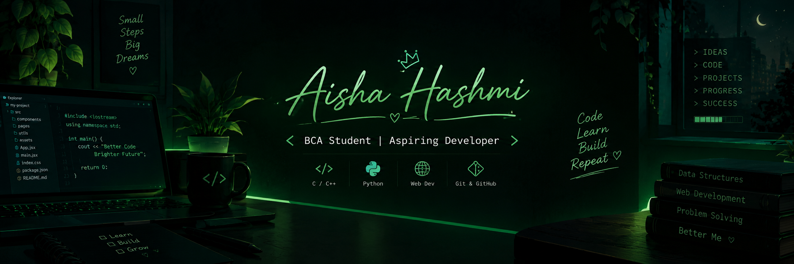

  

# Hey there, I'm Aisha Hashmi! 

  

### 💻 BCA Student | Aspiring Developer 🚀

🌱 Learning, building, and growing every day.

- 🎓 Currently pursuing BCA
- 💡 Interested in programming and problem-solving
- 🛠️ Exploring C, C++, Python, and Web Development
- 🚀 Building projects and learning new technologies
- ✨ Believe in learning by doing!

### 🧰 Tech Stack

  

### 🚀 Featured Projects

#### 💊 MediFind India
A medicine inventory management system designed to help manage medicine information and inventory.

#### 🤝 SkillSwap — Learn. Teach. Grow Together.
A skill-sharing platform concept where people can share their knowledge, learn new skills, and grow together by exchanging skills.

### 🌱 My Goal

To keep learning, build meaningful projects, and grow as a developer.

---

⭐ *"Code. Learn. Build. Repeat."*
